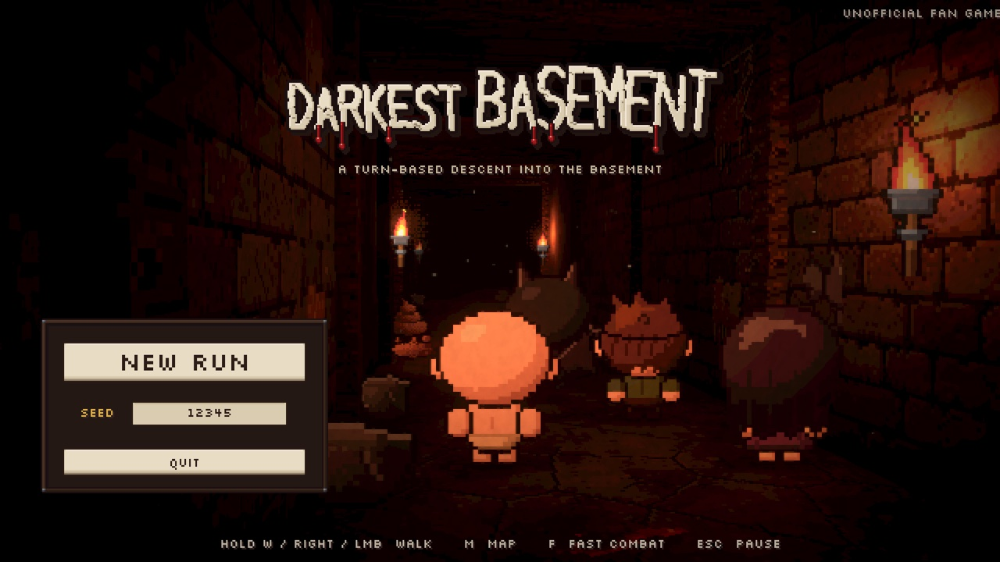
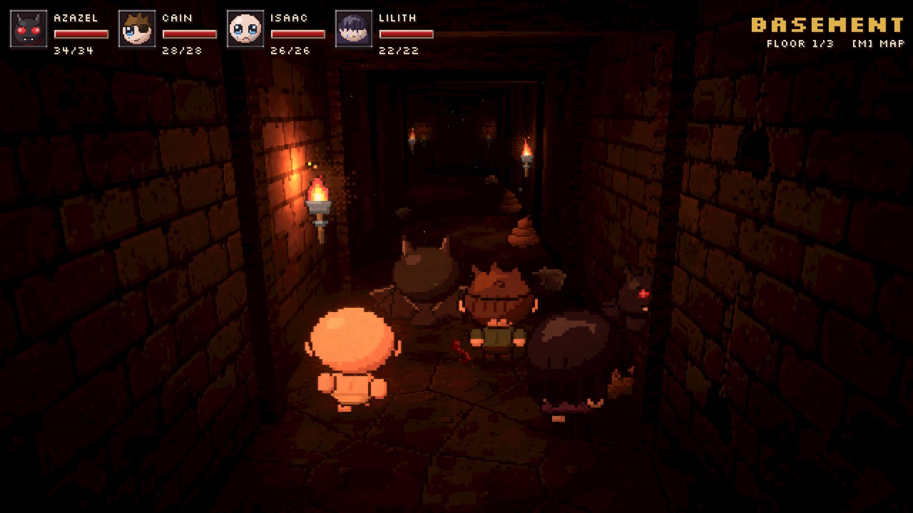
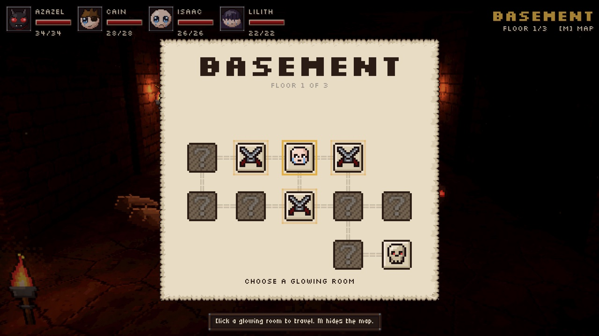
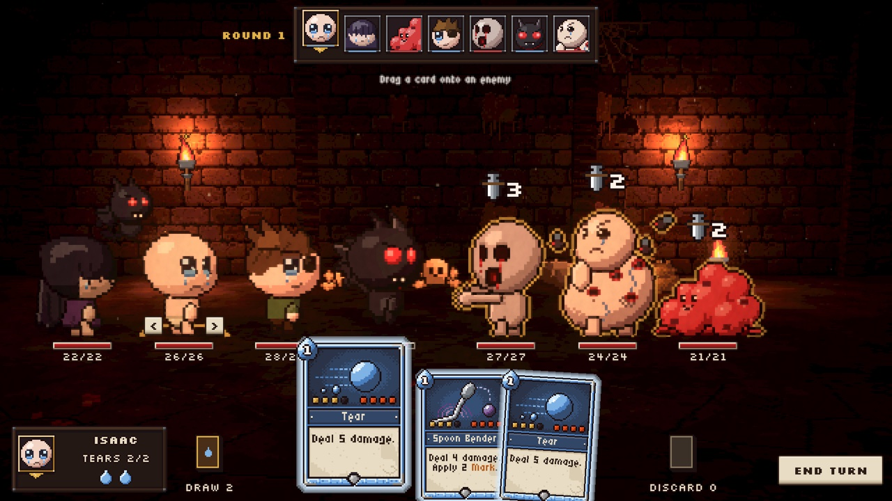
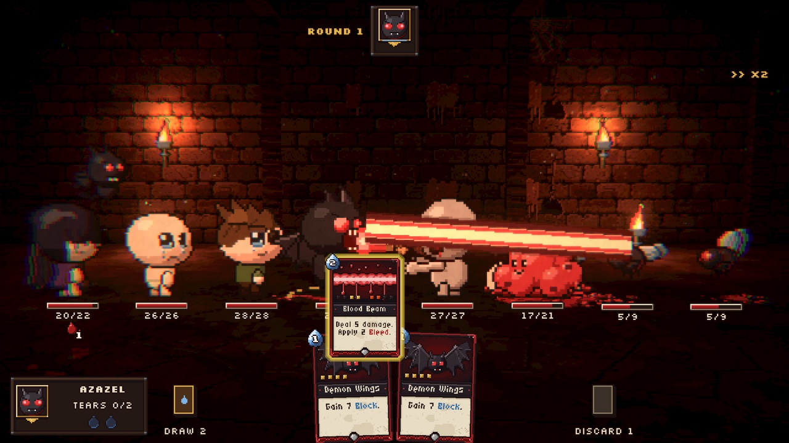
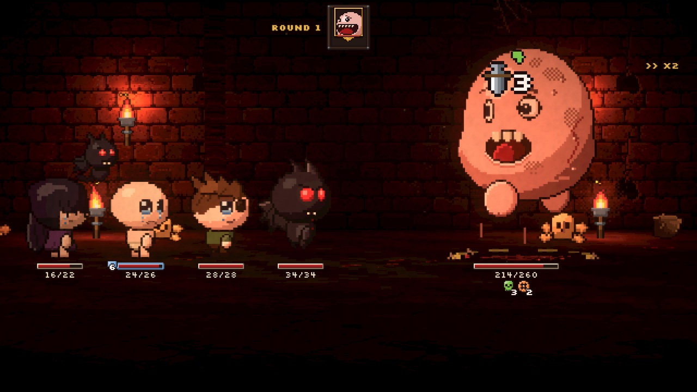
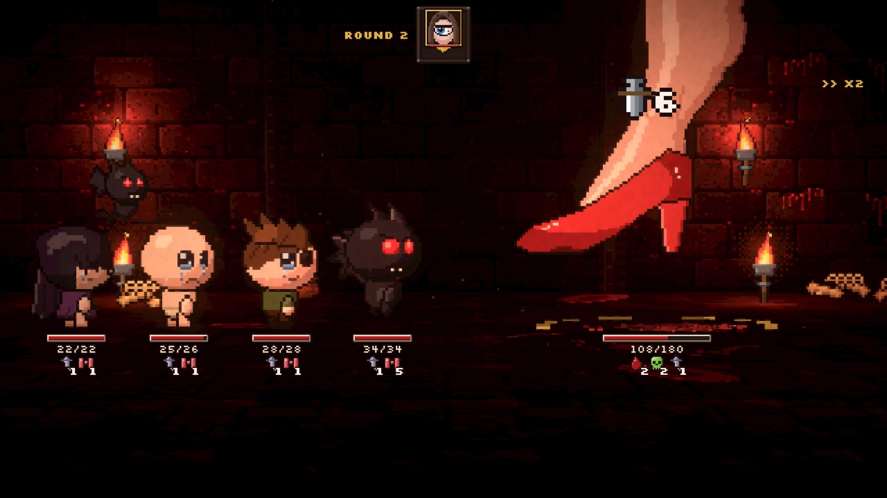

# Darkest Basement

Un roguelike pe ture făcut în **Unity (C#)**. Explorezi un subsol cu camere și holuri, ca în *Darkest Dungeon*. Lupți cu o echipă de patru eroi, fiecare cu pachetul lui de cărți-abilități, ca în *Slay the Spire*. Personajele, monștrii și stilul vin din *The Binding of Isaac*.

Proiect de facultate, fan game neoficial, necomercial.

## Joacă pe Windows (2 minute)

1. **Descarcă jocul:** [DarkestBasement-win.zip](https://github.com/Sulto4/darkest-basement/releases/latest/download/DarkestBasement-win.zip) (44 MB).
2. Click dreapta pe zip → **Extract All…** → **Extract**. Nu-l porni din interiorul zip-ului, că nu merge.
3. În folderul dezarhivat, dublu-click pe **`DarkestBasement.exe`**.
4. Dacă apare ecranul albastru „Windows protected your PC”: apasă **More info** → **Run anyway**. Apare pentru că jocul nu e semnat digital ca o aplicație comercială. E normal pentru un proiect de facultate.

Merge pe Windows 10/11, 64-bit, fără să instalezi nimic în plus. Un run complet durează 45–60 de minute.

### Controale

| Ce faci | Cum |
|---|---|
| Mergi pe hol | ții apăsat **W**, **→** sau **click stânga** |
| Harta (alegi camera următoare) | **M**, apoi click pe o cameră care strălucește |
| Joci o carte | o tragi pe țintă, sau click pe carte → click pe țintă, sau tasta **1–9** → click pe țintă |
| Termini tura | **Space** sau butonul **END TURN** |
| Lupta mai rapidă (×2) | **F** |
| Pauză | **Esc** |

Treci cu mouse-ul peste orice: cărți, statusuri, intenții, portrete. Fiecare are o explicație.

## Video: cum e făcut

[**Darkest Basement: cum e făcut**](https://github.com/Sulto4/darkest-basement/releases/latest/download/Darkest-Basement-cum-e-facut.mp4). E un video de ~14 minute, în română, despre fiecare parte a jocului și ideea de matematică din spatele ei: graful hărții și BFS, seed-uri și Fisher–Yates, formula de damage, coada de evenimente, simularea Monte Carlo pentru echilibrare, funcțiile de easing, plus ordinea în care ai învăța să construiești singur așa ceva.

## Cum arată

| | |
|---|---|
|  |  |
| Holul, cu echipa văzută din spate | Harta etajului (un graf de camere) |
|  |  |
| Lupta pe ranguri, cu mâna de cărți | Azazel și raza Brimstone |
|  |  |
| Monstro, boss-ul de la etajul 1 | Mom, boss-ul final |

## Cum funcționează jocul

- 3 etaje (Basement, Caves, Depths), fiecare cu harta lui generată aleatoriu și un boss: Monstro, Gurdy, Mom.
- Echipa: **Azazel** (tank, Brimstone de aproape), **Cain** (lovituri critice), **Isaac** (lacrimi de la distanță), **Lilith** (atacă prin Incubus, familiarul ei).
- Lupta e ca în Darkest Dungeon: eroii stau în stânga, inamicii în dreapta, pe ranguri de la 1 la 4. Fiecare acționează pe rând, după viteză. Inamicii își arată intenția înainte să atace.
- La fiecare tură, eroul activ trage 3 cărți din pachetul lui și are 2 „tears” (energie).
- După fiecare luptă câștigată primești o carte random, pe care o iei sau o lași. În Bedroom te vindeci, scoți o carte din pachet sau îmbunătățești una.
- Fiecare run are un **seed**: același seed înseamnă exact același run.

Designul complet: [docs/GDD.md](docs/GDD.md).

## Pentru cine vrea să vadă codul

| Unde | Ce |
|---|---|
| [docs/ARCHITECTURE.md](docs/ARCHITECTURE.md) | Ideea centrală: **logica** (Model, C# pur, fără Unity) e separată de **ce vezi** (View). Modelul produce evenimente, iar View-ul le animează pe rând. |
| `Assets/_Game/Scripts/Model/` | Regulile jocului: harta, lupta, cărțile, inamicii, recompensele, AI-ul. Se poate testa fără Unity. |
| `Assets/_Game/Scripts/` (restul) | Partea vizuală: holul 3D, camera, luptă, UI, efecte, sunet. |
| `tools/sim/` | 36 de teste și o simulare care joacă 500 de run-uri automat și măsoară echilibrul (rata de victorie e 43,8%). |
| [docs/BALANCE.md](docs/BALANCE.md) | Cum s-au calibrat cifrele. |
| `tools/art/` | Scripturile Python care desenează toată arta pixel. |

### Deschide proiectul în Unity

1. Instalează [Unity Hub](https://unity.com/download) și editorul **Unity 6000.3.26f1** (Unity 6.3 LTS). Licența Personal e gratuită.
2. Clonează repo-ul: `git clone https://github.com/Sulto4/darkest-basement.git`
3. Unity Hub → **Add** → **Add project from disk** → folderul clonat. La prima deschidere importul durează câteva minute.
4. Deschide scena `Assets/_Game/Scenes/Main.unity` și apasă **Play**.

Testele logicii, fără Unity (cer .NET 8 SDK): `bash tools/sim/run.sh`.

---

Personajele și monștrii aparțin seriei *The Binding of Isaac* (Edmund McMillen / Nicalis). Arta din proiect e desenată de noi, în stilul lor. Fan game necomercial, făcut pentru învățare.
